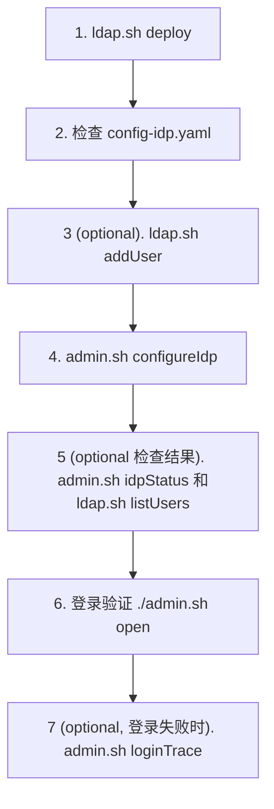

# 03 — 安装

## 3.1 安装方式

本环境已登录 `cp.icr.io`,集群直接从 IBM Container Registry 拉取镜像(Connected mode)。


## 3.2 预演

```bash

./entitle.sh plan
```

## 3.3 执行安装

```bash
./entitle.sh install # 不包括模型配置
```

## 3.4 IDP / LDAP
Bob 自带 Keycloak。二选一:

- **LDAP/AD 联邦**:用企业账号登录。
- **Keycloak 直接用户**:在 Keycloak 中创建用户,适合评估环境。


> 邮箱域(`example.com`)和 LDAP host是两回事,不要混用。

## 调用顺序



vendor implementation
- [389ds](./389ds-ldap.md)

## 3.4 安装后更新模型配置


```bash
./admin.sh updateModel

./admin.sh modelStatus # 校验
```

