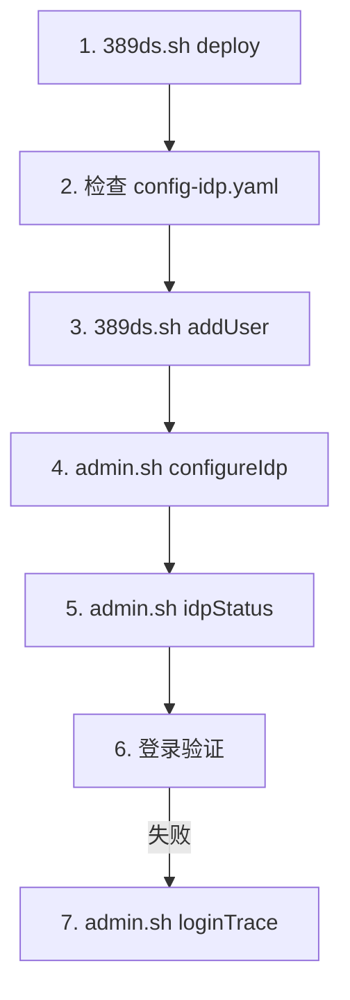

# 07 — 用 389ds 作为 LDAPS 后端(rhds)

> 草稿。在 Bob 已安装并 Ready(完成 01–04)之后进行,是 [05-post-install.md](./05-post-install.md) 5.2 的一个具体实现:把 389ds 部署进同一个集群,再用 `bobctl configure-idp` 接入 Keycloak。

所有命令都在 `bob/onprem/` 目录下执行,且 `oc` 已登录集群。

## 为什么放在集群内

LDAPS 要求 `connectionUrl` 里的主机名出现在服务器证书的 SAN 中,并且 Keycloak pod 能解析、能连通它。部署在集群内,地址固定为:

```
ldaps://ds389.ibm-bob.svc.cluster.local:636
```

这个名字由 Service 提供,不依赖宿主机 IP、WiFi 或防火墙。邮箱域(`example.com`)和 LDAP 主机名是两回事,不要混用。

## 脚本分工

| 脚本 | 作用 |
| ---- | ---- |
| [`389ds.sh`](./389ds.sh) | 部署和维护 389ds:证书、工作负载、目录、Secret、用户、写入 `config-idp.yaml` |
| [`admin.sh`](./admin.sh) | 应用 IDP 配置并排查登录:`configureIdp`、`idpStatus`、`bobUrls`、`loginTrace` |
| `bobctl configure-idp` | 由 `admin.sh configureIdp` 调用,不需要 entitlement key |

## 调用顺序



### 1. 部署 389ds

```bash
./389ds.sh deploy
```

`deploy` 依次执行下面这些步骤,它们也可以单独运行:

| 步骤 | 函数 | 结果 |
| ---- | ---- | ---- |
| 1 | `certs` | 用 cert-manager 签发自签 CA `ds389-ca` 和服务器证书 `ds389-tls`,SAN 为 `ds389.ibm-bob.svc.cluster.local`、`ds389.ibm-bob.svc`、`ds389` |
| 2 | `adminSecret` | 随机生成 Directory Manager 密码,存入 Secret `ds389-admin` |
| 3 | `workload` | 创建 PVC、Deployment、Service;证书 Secret 按 `/data/tls/` 布局挂载,镜像启动时自动导入 |
| 4 | `initDirectory` | 创建后缀 `dc=example,dc=com`、`ou=People`、`ou=Groups`、`ou=ServiceAccounts`,以及绑定账号 `bob-svc`(随机密码存入 Secret `corp-ldap-bind`) |
| 5 | `caSecret` | 把 CA 证书存入 Secret `corp-ldap-ca`(key 为 `ca.crt`) |
| 6 | `idpInject` | 向 `config/config-idp.yaml` 的 `ldaps` 追加一项,并打印 diff |

所有步骤都可重复执行,已存在的资源会跳过。

验证:

```bash
./389ds.sh status
./389ds.sh testFromKeycloak   # Keycloak pod 到 389ds:636 的 TCP 连通
```

### 2. 检查 `config-idp.yaml`

```bash
git diff config/config-idp.yaml
```

确认三点:

- **provider 名字**。`idpInject` 用的是 `389ds.sh` 里的 `IDP_NAME`(当前为 `389-ds`),它只按名字判断是否已存在,**不会识别名字不同、但指向同一个 LDAP 的项**。全新环境里 `config-idp.yaml` 是模板(`ldaps:` 为注释),不会有这个问题。只有在文件里已经手写过 provider(例如另一个名字)再运行 `idpInject` 时,才会得到两个指向同一 LDAP 的 provider;此时删掉其中一项,或把 `IDP_NAME` 改成现有的名字。
- **缩进**。`configure-idp.sh` 的解析器要求列表项缩进 2 个空格(`  - `)、字段缩进 4 个空格。缩进不对时,整个 `ldaps` 段会被静默忽略,不会报错。
- **`uuidLDAPAttribute: nsUniqueId`**。389ds 没有模板里的 `entryUUID`。

> provider 的名字是 Keycloak 里组件的显示名,首次配置后不要再改。

### 3. 添加用户

```bash
./389ds.sh addUser alice alice@example.com '<password>'
```

建议在第 4 步之前加好。`userSync.enabled: true` 只在**创建 provider 时**触发一次全量同步,此后新增的用户不会被自动导入。

### 4. 应用 IDP 配置

```bash
./admin.sh configureIdp --dry-run   # 只预演,检查渲染结果和 Secret 是否存在
./admin.sh configureIdp             # 先 dry-run,再真正应用
```

等价于在发行包目录里运行 `./bobctl configure-idp --config ../config/config-idp.yaml`。默认等待 600 秒,可用 `BOB_IDP_WAIT_TIMEOUT=900` 调整。

### 5. 检查结果

```bash
./admin.sh idpStatus
```

期望看到:

```
bob-idp   True   Last reconciliation succeeded
<name>    LDAPRegistered         True
<name>    LDAPReachable          True
<name>    LDAPAuthenticated      True
<name>    LDAPUserSyncSucceeded  True
```

也可以单独验证 LDAPS 校验和 `bob-svc` 绑定:

```bash
./389ds.sh testLdaps
```

### 6. 登录验证

```bash
./admin.sh bobUrls
```

打开输出里的登录页(本机 CRC 为 `https://bob.ibm-bob.apps-crc.testing`),用 LDAP 用户的邮箱和密码登录。证书是自签的,先用 `./bobctl get-ca-cert --output bob-ca.crt` 取 CA 并导入浏览器,或临时选择继续访问。

### 7. 登录失败时

```bash
./admin.sh loginTrace alice@example.com        # 默认看最近 15 分钟
SINCE=1h ./admin.sh loginTrace alice@example.com
```

它依次查 Keycloak 认证、`bob-authn` 权限查询、`bob-admin` 的 SCIM 开通。

## 常见现象

| 现象 | 原因与处理 |
| ---- | ---------- |
| 新用户首次登录出现 `account_not_provisioned`("Account Not Ready Yet") | 用户在 LDAP 认证通过的当下,Bob 里还没有这个账号;Keycloak 再通过 SCIM 同步过去,有 1 到 2 分钟的间隔。`loginTrace` 里看到 `SCIM Create: user provisioned` 后重新登录即可 |
| `ldaps` 段完全没出现在渲染出的 CR 里 | 缩进不是 2/4 个空格,见第 2 步 |
| `LDAPReachable` 失败 | `./389ds.sh testFromKeycloak`;确认 `connectionUrl` 的主机名在证书 SAN 里 |
| `LDAPAuthenticated` 失败 | 确认 `corp-ldap-bind` 里的密码与 `bob-svc` 一致;`./389ds.sh testLdaps` |

## 可变参数

`389ds.sh` 顶部可通过环境变量覆盖:

| 变量 | 默认值 | 说明 |
| ---- | ------ | ---- |
| `BASE_DN` | `dc=example,dc=com` | 目录后缀 |
| `STORAGE` | `2Gi` | PVC 大小 |
| `BIND_SECRET` | `corp-ldap-bind` | 绑定密码 Secret,需与 `config-idp.yaml` 一致 |
| `CA_SECRET` | `corp-ldap-ca` | CA 证书 Secret,需与 `config-idp.yaml` 一致 |

命名空间(`ibm-bob`)、Service 名(`ds389`)和镜像(`quay.io/389ds/dirsrv:latest`)直接写在脚本里。要改 Service 名或命名空间,需要同时改 `certs` 的 `dnsNames`、`workload` 的 Service、`testLdaps` 和 `_idpItem`。

## 清理

```bash
./389ds.sh uninstall
oc delete pvc ds389-data -n ibm-bob   # 彻底清除目录数据
```

`uninstall` 会删除 Deployment、Service、证书、Issuer 和 Secret,但**保留 PVC**。它不会修改 `config-idp.yaml`,也不会删除 `BobIdp` 里已经配置的 provider;要移除 provider,需要先编辑 `config-idp.yaml` 再重新应用。

## 注意

- `ds389` 的 Directory Manager 密码取自 Secret:`oc get secret ds389-admin -n ibm-bob -o jsonpath='{.data.password}' | base64 -d`。
- 这是测试环境的部署:单副本、不做备份、CA 自签。生产环境请使用企业 LDAP 和企业 CA。
