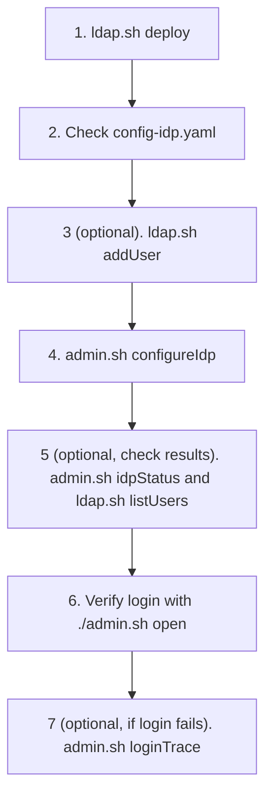

# 03 — Installation

## Connected mode installation
Dry run

```bash

./entitle.sh plan
```

Run the installation

```bash
./entitle.sh install # Does not include model configuration
```

### Configure IDP / LDAP
Bob ships with Keycloak. Choose one of the two:

- **LDAP/AD federation**: sync with enterprise accounts.
- **Keycloak local users**: create users in Keycloak (for evaluation only).


> The email domain (`example.com`) and the LDAP host are two different things; do not mix them up.




LDAP vendor that provide ldap.sh
- [389ds](../ldap/389ds/README.md)

### Update model configuration

> TODO if ldap is not configured by the moment

```bash
./admin.sh updateModel

./admin.sh modelStatus # verify
```

