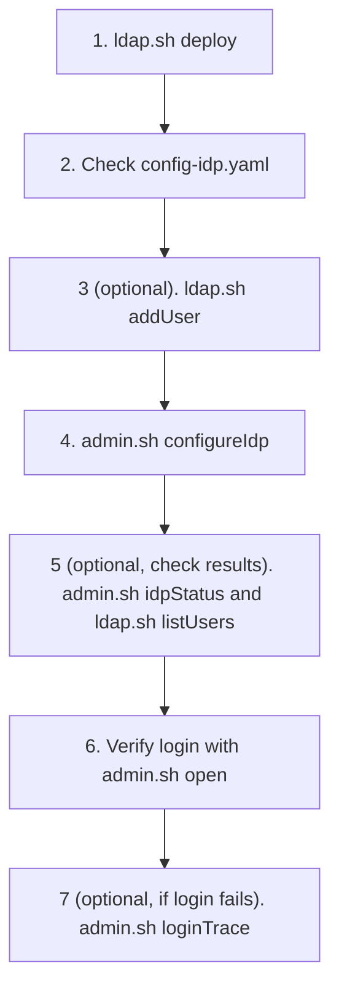

# Using 389ds as the LDAPS backend (rhds)


## Run 389ds inside the cluster

reason: LDAPS requires the hostname in `connectionUrl` to appear in the server certificate's SAN, and the Keycloak pod must be able to resolve and reach it. When deployed inside the cluster, the address is fixed as:

```
ldaps://ds389.ibm-bob.svc.cluster.local:636
```

This name is provided by the Service and does not depend on the host IP, WiFi, or firewall.


## Script responsibilities

| Script | Purpose |
| ------ | ------- |
| [`ldap.sh`](./ldap.sh) | Deploys and maintains 389ds: certificates, workload, directory, Secrets, users, and writes to `config-idp.yaml` |
| [`admin.sh`](../../admin.sh) | Applies the IDP configuration and troubleshoots |

## Call sequence



### 1. Deploy 389ds

```bash
./ldap.sh deploy
```

`deploy` runs the following steps in order; they can also be run individually:

| Step | Function | Result |
| ---- | -------- | ------ |
| 1 | `certs` | Uses cert-manager to issue the self-signed CA `ds389-ca` and the server certificate `ds389-tls`, with SANs `ds389.ibm-bob.svc.cluster.local`, `ds389.ibm-bob.svc`, and `ds389` |
| 2 | `adminSecret` | Randomly generates the Directory Manager password and stores it in the Secret `ds389-admin` |
| 3 | `workload` | Creates the PVC, Deployment, and Service; the certificate Secret is mounted following the `/data/tls/` layout and imported automatically when the image starts |
| 4 | `initDirectory` | Creates the suffix `dc=example,dc=com`, `ou=People`, `ou=Groups`, `ou=ServiceAccounts`, and the bind account `bob-svc` (random password stored in the Secret `corp-ldap-bind`) |
| 5 | `caSecret` | Stores the CA certificate in the Secret `corp-ldap-ca` (key `ca.crt`) |
| 6 | `idpInject` | Appends an entry to `ldaps` in `config/config-idp.yaml` and prints the diff |

All steps are idempotent; existing resources are skipped.

Verify:

```bash
./ldap.sh status
./ldap.sh testFromKeycloak   # TCP connectivity from the Keycloak pod to 389ds:636
```

### 2. Check `config-idp.yaml`

Confirm the following:


- **`uuidLDAPAttribute: nsUniqueId`**. This attribute tells Keycloak which attribute of the LDAP entry to use as the user's unique, immutable ID. `nsUniqueId` is chosen here because it is a native 389ds attribute that is guaranteed to exist on every entry and does not depend on the `entryuuid` plugin (for example, entries migrated from older versions may not have `entryUUID`). Do not change it after the initial configuration, otherwise Keycloak will treat existing users as new users.


### 3. Add users

```bash
./ldap.sh addUser alice alice@example.com
```

Enter the password interactively at the prompt (no echo, entered only once).

### 4. Apply the IDP configuration

```bash
./admin.sh configureIdp
```
It waits 600 seconds by default; this can be adjusted with `BOB_IDP_WAIT_TIMEOUT=900`.

### 5. Check the results

```bash
./admin.sh idpStatus
```

Expected output:

```
NAME      READY   MESSAGE                         AGE
bob-idp   True    Last reconciliation succeeded   11h
389-ds  LDAPRegistered  True    LDAP provider registered in Keycloak
389-ds  LDAPReachable   True    LDAP server is reachable
389-ds  LDAPAuthenticated       True    LDAP bind credentials are valid
389-ds  LDAPUserSyncSucceeded   True    Initial LDAP user sync completed successfully

```

You can also verify the LDAPS validation and the `bob-svc` bind separately:

```bash
./ldap.sh listUsers
```

### 6. Verify login

```bash
./admin.sh open
```

Open the login page shown in the output (for local CRC, `https://bob.ibm-bob.apps-crc.testing`) and log in with an LDAP user's email and password. The certificate is self-signed: first fetch the CA with `./bobctl get-ca-cert --output bob-ca.crt` and import it into the browser, or temporarily choose to proceed anyway.

### 7. If login fails

```bash
./admin.sh loginTrace alice@example.com        # By default looks at the last 15 minutes
SINCE=1h ./admin.sh loginTrace alice@example.com
```

It checks, in order, Keycloak authentication, the `bob-authn` permission query, and the SCIM provisioning in `bob-admin`.

## Common symptoms

| Symptom | Cause and resolution |
| ------- | -------------------- |
| A new user sees `account_not_provisioned` ("Account Not Ready Yet") on first login | At the moment the user passes LDAP authentication, the account does not yet exist in Bob; Keycloak then syncs it over via SCIM, with a delay of 1 to 2 minutes. Once `SCIM Create: user provisioned` appears in `loginTrace`, log in again |

## Configurable parameters

The following can be overridden through environment variables at the top of `ldap.sh`:

| Variable | Default | Description |
| -------- | ------- | ----------- |
| `BASE_DN` | `dc=example,dc=com` | Directory suffix |
| `STORAGE` | `2Gi` | PVC size |
| `BIND_SECRET` | `corp-ldap-bind` | Bind password Secret; must match `config-idp.yaml` |
| `CA_SECRET` | `corp-ldap-ca` | CA certificate Secret; must match `config-idp.yaml` |


## Cleanup

```bash
./ldap.sh uninstall # Deletes the Deployment, Service, certificates, Issuer, and Secrets, but keeps the PVC.
oc delete pvc ds389-data -n ibm-bob   # Completely removes the directory data
```

It does not modify `config-idp.yaml`, nor does it remove the providers already configured in `BobIdp`; to remove a provider, edit `config-idp.yaml` first and then re-apply.

## Notes

- The `ds389` Directory Manager password is taken from the Secret: `oc get secret ds389-admin -n ibm-bob -o jsonpath='{.data.password}' | base64 -d`.
- This is a test-environment deployment: single replica, no backups, self-signed CA. For production, use an enterprise LDAP and an enterprise CA.
